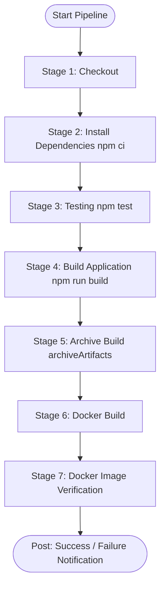

# Node.js Task Manager REST API with Jenkins CI/CD Pipeline

A modern, production-ready, beginner-friendly Task Manager REST API built with Node.js 22, Express, and TypeScript, featuring automated testing with Jest and Supertest, containerization with Docker multi-stage builds, and an end-to-end declarative Jenkins CI/CD pipeline.

---

## Table of Contents

1. [Project Introduction](#1-project-introduction)
2. [Technology Stack](#2-technology-stack)
3. [Project Directory Structure](#3-project-directory-structure)
4. [Prerequisites](#4-prerequisites)
5. [Local Installation Instructions](#5-local-installation-instructions)
6. [Commands to Run the Application](#6-commands-to-run-the-application)
7. [API Endpoints & Example Requests](#7-api-endpoints--example-requests)
8. [Testing Instructions](#8-testing-instructions)
9. [Production Build Instructions](#9-production-build-instructions)
10. [Docker Build & Run Instructions](#10-docker-build--run-instructions)
11. [Jenkins Installation Prerequisites](#11-jenkins-installation-prerequisites)
12. [Jenkins Pipeline Configuration](#12-jenkins-pipeline-configuration)
13. [How to Connect GitHub Repository to Jenkins](#13-how-to-connect-github-repository-to-jenkins)
14. [How to Execute and Verify the CI/CD Pipeline](#14-how-to-execute-and-verify-the-cicd-pipeline)

---

## 1. Project Introduction

The **Node.js Task Manager REST API** is an enterprise-structured starter application designed to demonstrate modern Node.js and DevOps best practices. It implements:

- A modular layered architecture separating controllers, business services, routing, validation, and error handling.
- Strongly typed domain models and data transfer objects (DTOs) with TypeScript.
- In-memory data store with thread-safe simulation and test-isolation resets.
- Multi-stage Docker packaging enforcing security best practices (non-root execution, minimal Alpine footprint, pruned devDependencies).
- Fully automated continuous integration and continuous deployment (CI/CD) with a 7-stage declarative Jenkins pipeline.

---

## 2. Technology Stack

| Layer | Technology | Purpose |
| :--- | :--- | :--- |
| **Runtime** | [Node.js 22 (LTS)](https://nodejs.org/) | Server runtime environment |
| **Framework** | [Express.js 4](https://expressjs.com/) | Fast, unopinionated HTTP web framework |
| **Language** | [TypeScript 5](https://www.typescriptlang.org/) | Static type safety and developer productivity |
| **Testing** | [Jest](https://jestjs.io/) & [Supertest](https://github.com/ladjs/supertest) | Unit and HTTP API integration testing |
| **Containerization** | [Docker](https://www.docker.com/) | Multi-stage, non-root Alpine container packaging |
| **CI/CD** | [Jenkins](https://www.jenkins.io/) | Declarative pipeline automation and artifact archiving |
| **VCS** | [Git](https://git-scm.com/) | Source code version control |

---

## 3. Project Directory Structure

```plaintext
task-manager/
├── .dockerignore                 # Excludes build caches & dependencies from Docker context
├── .gitignore                    # Git file exclusion rules
├── Dockerfile                    # Production multi-stage Docker build file
├── Jenkinsfile                   # Declarative 7-stage CI/CD pipeline definition
├── jest.config.js                # Jest test runner configuration
├── package.json                  # Dependencies, metadata, and lifecycle scripts
├── package-lock.json             # Exact dependency tree lockfile for deterministic npm ci
├── tsconfig.json                 # TypeScript compiler configuration
├── README.md                     # Comprehensive project documentation
├── dist/                         # Compiled JavaScript output (generated on build)
├── src/                          # TypeScript source code
│   ├── app.ts                    # Express application configuration and middleware mounting
│   ├── server.ts                 # Server initialization, port listener, and graceful shutdown
│   ├── controllers/              # HTTP request and response orchestration
│   │   ├── health.controller.ts  # Health check handler
│   │   └── task.controller.ts    # CRUD task request handlers
│   ├── middleware/               # Express request pipeline middleware
│   │   ├── errorHandler.ts       # Centralized error handler and standard JSON error response
│   │   ├── notFoundHandler.ts    # 404 handler for unknown routes
│   │   ├── requestLogger.ts      # Request logging middleware
│   │   └── validateTask.ts       # Schema validation for create/update operations
│   ├── routes/                   # API endpoint route declarations
│   │   ├── health.routes.ts      # /health route definitions
│   │   ├── index.ts              # Route aggregator
│   │   └── task.routes.ts        # /api/tasks route definitions
│   ├── services/                 # Core business logic and data manipulation
│   │   └── task.service.ts       # In-memory Task store and CRUD logic
│   └── types/                    # Shared TypeScript interfaces and types
│       ├── error.types.ts        # Custom AppError class definition
│       └── task.types.ts         # Task entity, DTOs, and ApiResponse contracts
└── tests/                        # Automated test suites
    ├── integration/              # Supertest HTTP endpoint integration tests
    │   ├── health.api.test.ts    # Integration test for /health and root
    │   └── task.api.test.ts      # Integration tests for /api/tasks endpoints
    └── unit/                     # Isolated unit tests
        └── task.service.test.ts  # TaskService unit tests
```

---

## 4. Prerequisites

Before running the project locally or setting up CI/CD, ensure the following software is installed:

- **Node.js**: `v22.x` or higher ([Download Node.js](https://nodejs.org/))
- **npm**: `v10.x` or higher (bundled with Node.js)
- **Docker**: `v20.x` or higher ([Install Docker Engine](https://docs.docker.com/engine/install/))
- **Git**: `v2.x` or higher ([Install Git](https://git-scm.com/))
- **Jenkins**: `v2.400+` (for running the CI/CD pipeline)

Verify installed versions on your machine:

```bash
node -v
npm -v
docker --version
git --version
```

---

## 5. Local Installation Instructions

1. **Clone the repository**:
   ```bash
   git clone <your-repository-url>
   cd task-manager
   ```

2. **Install project dependencies using deterministic lockfile**:
   ```bash
   npm ci
   ```
   *(Alternatively, for general development installations: `npm install`)*

3. **Verify the environment**:
   No external database is required because the initial version uses high-performance in-memory storage.

---

## 6. Commands to Run the Application

| Command | Environment | Description |
| :--- | :--- | :--- |
| `npm run dev` | Development | Runs hot-reloading development server via `tsx` on `http://localhost:3000` |
| `npm run build` | Build | Compiles TypeScript source from `src/` to `dist/` |
| `npm start` | Production | Starts the compiled production JavaScript server (`node dist/server.js`) |
| `npm test` | Testing | Runs all Jest unit and integration tests |
| `npm run test:coverage`| Testing | Executes tests and generates an HTML code coverage report |

### Starting in Development Mode
```bash
npm run dev
```

### Starting in Production Mode
```bash
npm run build
npm start
```

---

## 7. API Endpoints & Example Requests

Base URL: `http://localhost:3000`

### 1. Health Check
- **Endpoint**: `GET /health`
- **Description**: Returns application health status, uptime, and runtime environment.
- **Example cURL**:
  ```bash
  curl -X GET http://localhost:3000/health
  ```
- **Response (`200 OK`)**:
  ```json
  {
    "status": "UP",
    "timestamp": "2026-11-14T12:44:09.646Z",
    "uptime": 15,
    "environment": "development",
    "version": "1.0.0"
  }
  ```

---

### 2. Retrieve All Tasks
- **Endpoint**: `GET /api/tasks`
- **Query Parameters (Optional)**:
  - `status`: Filter by `pending`, `in-progress`, or `completed`
  - `priority`: Filter by `low`, `medium`, or `high`
- **Example cURL**:
  ```bash
  # Get all tasks
  curl -X GET http://localhost:3000/api/tasks

  # Filter by status and priority
  curl -X GET "http://localhost:3000/api/tasks?status=pending&priority=high"
  ```
- **Response (`200 OK`)**:
  ```json
  {
    "success": true,
    "data": [
      {
        "id": "7da675b4-64d8-4be0-bb54-73cac19e68a9",
        "title": "Containerize Task Manager API",
        "description": "Create multi-stage Dockerfile using Alpine base image",
        "status": "completed",
        "priority": "high",
        "createdAt": "2026-11-14T12:43:53.818Z",
        "updatedAt": "2026-11-14T12:43:53.818Z"
      }
    ],
    "message": "Retrieved 1 task(s)"
  }
  ```

---

### 3. Create a New Task
- **Endpoint**: `POST /api/tasks`
- **Headers**: `Content-Type: application/json`
- **Body Parameters**:
  - `title` *(string, required)*: Max 150 characters
  - `description` *(string, optional)*
  - `status` *(string, optional)*: `pending` (default), `in-progress`, `completed`
  - `priority` *(string, optional)*: `low`, `medium` (default), `high`
- **Example cURL**:
  ```bash
  curl -X POST http://localhost:3000/api/tasks \
    -H "Content-Type: application/json" \
    -d '{
      "title": "Configure Jenkins Pipeline",
      "description": "Implement automated build, test, and container packaging stages",
      "status": "pending",
      "priority": "high"
    }'
  ```
- **Response (`201 Created`)**:
  ```json
  {
    "success": true,
    "data": {
      "id": "c61b2447-9f44-4dd2-8350-0d603a9f0290",
      "title": "Configure Jenkins Pipeline",
      "description": "Implement automated build, test, and container packaging stages",
      "status": "pending",
      "priority": "high",
      "createdAt": "2026-11-14T12:45:10.123Z",
      "updatedAt": "2026-11-14T12:45:10.123Z"
    },
    "message": "Task created successfully"
  }
  ```

---

### 4. Retrieve a Specific Task by ID
- **Endpoint**: `GET /api/tasks/:id`
- **Example cURL**:
  ```bash
  curl -X GET http://localhost:3000/api/tasks/c61b2447-9f44-4dd2-8350-0d603a9f0290
  ```
- **Response (`200 OK`)**:
  ```json
  {
    "success": true,
    "data": {
      "id": "c61b2447-9f44-4dd2-8350-0d603a9f0290",
      "title": "Configure Jenkins Pipeline",
      "description": "Implement automated build, test, and container packaging stages",
      "status": "pending",
      "priority": "high",
      "createdAt": "2026-11-14T12:45:10.123Z",
      "updatedAt": "2026-11-14T12:45:10.123Z"
    }
  }
  ```
- **Error Response (`404 Not Found`)**:
  ```json
  {
    "success": false,
    "error": "Task with id 'invalid-id' not found"
  }
  ```

---

### 5. Update an Existing Task
- **Endpoint**: `PUT /api/tasks/:id`
- **Headers**: `Content-Type: application/json`
- **Example cURL**:
  ```bash
  curl -X PUT http://localhost:3000/api/tasks/c61b2447-9f44-4dd2-8350-0d603a9f0290 \
    -H "Content-Type: application/json" \
    -d '{
      "status": "in-progress",
      "priority": "high"
    }'
  ```
- **Response (`200 OK`)**:
  ```json
  {
    "success": true,
    "data": {
      "id": "c61b2447-9f44-4dd2-8350-0d603a9f0290",
      "title": "Configure Jenkins Pipeline",
      "description": "Implement automated build, test, and container packaging stages",
      "status": "in-progress",
      "priority": "high",
      "createdAt": "2026-11-14T12:45:10.123Z",
      "updatedAt": "2026-11-14T12:48:30.456Z"
    },
    "message": "Task updated successfully"
  }
  ```

---

### 6. Delete a Task
- **Endpoint**: `DELETE /api/tasks/:id`
- **Example cURL**:
  ```bash
  curl -X DELETE http://localhost:3000/api/tasks/c61b2447-9f44-4dd2-8350-0d603a9f0290
  ```
- **Response (`200 OK`)**:
  ```json
  {
    "success": true,
    "message": "Task with id 'c61b2447-9f44-4dd2-8350-0d603a9f0290' deleted successfully"
  }
  ```

---

## 8. Testing Instructions

The project includes unit tests for isolated domain logic and integration tests for full HTTP request pipelines using Jest and Supertest.

### Run All Tests
```bash
npm test
```

### Run Tests with Coverage Report
```bash
npm run test:coverage
```

### Test Scope
- **`tests/unit/task.service.test.ts`**:
  - Tests task creation with defaults (status `pending`, priority `medium`).
  - Tests whitespace trimming and field validations.
  - Tests query filtering (status, priority).
  - Tests retrieval by ID, updating, and deletion.
- **`tests/integration/task.api.test.ts`**:
  - Validates `POST /api/tasks` response code `201` and required field validation (`400 Bad Request`).
  - Validates `GET /api/tasks` retrieval and query filtering.
  - Validates `GET /api/tasks/:id` positive (`200`) and negative (`404`) paths.
  - Validates `PUT /api/tasks/:id` updates and validation on empty payloads (`400`).
  - Validates `DELETE /api/tasks/:id` positive (`200`) and negative (`404`) paths.
  - Validates 404 handler for undefined routes.
- **`tests/integration/health.api.test.ts`**:
  - Validates `GET /health` returns status `UP`, uptime, and environment.

---

## 9. Production Build Instructions

To compile the TypeScript source into production-ready JavaScript:

```bash
npm run build
```

This invokes the TypeScript compiler (`tsc`), outputting compiled JavaScript files, declaration files (`.d.ts`), and source maps into the `dist/` folder:

```plaintext
dist/
├── app.js
├── app.d.ts
├── server.js
├── server.d.ts
├── controllers/
├── middleware/
├── routes/
├── services/
└── types/
```

Verify the build output:
```bash
test -d dist && test -f dist/server.js && echo "Production build verified successfully!"
```

To run the compiled production application:
```bash
npm start
```

---

## 10. Docker Build & Run Instructions

The application uses a **multi-stage Dockerfile** based on Alpine Linux:
- **Stage 1 (`builder`)**: Installs full dependencies, compiles TypeScript, and prunes devDependencies.
- **Stage 2 (`runner`)**: Uses a clean `node:22-alpine` image, copies compiled `dist/` and production `node_modules`, switches to the non-root user `node`, and defines a `HEALTHCHECK`.

### Build Docker Image
```bash
docker build -t node-task-manager:latest -t node-task-manager:1 .
```

### Run Docker Container
```bash
docker run -d \
  --name task-manager-container \
  -p 3000:3000 \
  --restart unless-stopped \
  node-task-manager:latest
```

### Verify Container Execution & Health
```bash
# Check container status
docker ps --filter "name=task-manager-container"

# View application logs
docker logs task-manager-container

# Test health check from host
curl -s http://localhost:3000/health
```

### Stop and Clean Up Container
```bash
docker stop task-manager-container
docker rm task-manager-container
```

---

## 11. Jenkins Installation Prerequisites

To run this pipeline on a Jenkins server, the Jenkins environment requires:

### Required System Software
1. **Git** (version 2.x+)
2. **Node.js 22 & npm 10+** (accessible on Jenkins agent `PATH` or configured via the Jenkins NodeJS plugin)
3. **Docker CLI** and **Docker Daemon** access

### Required Jenkins Plugins
- **Pipeline** (Workflow Aggregator)
- **Git Plugin**
- **NodeJS Plugin** (Optional if Node 22 is installed globally on the Jenkins host)

### Docker Permissions for Jenkins User
On an Ubuntu or Debian Jenkins host, the `jenkins` user must have permission to interact with the Docker daemon without `sudo`:

```bash
# 1. Add jenkins user to docker group
sudo usermod -aG docker jenkins

# 2. Restart Jenkins service to apply new group membership
sudo systemctl restart jenkins
```

Verify permissions:
```bash
sudo -u jenkins docker ps
```

---

## 12. Jenkins Pipeline Configuration

The pipeline is defined in `Jenkinsfile` at the root of the project using declarative pipeline syntax:



### Pipeline Stages Breakdown

1. **Stage 1: Checkout**
   - Pulls the latest commit from the configured Git branch using `checkout scm`.
2. **Stage 2: Install Dependencies**
   - Executes `npm ci` for fast, deterministic, clean-room dependency installation.
3. **Stage 3: Testing**
   - Executes `npm test`.
   - Fails the pipeline immediately if any unit or integration test fails.
4. **Stage 4: Build Application**
   - Executes `npm run build` (`tsc`).
   - Verifies the presence of `dist/` and `dist/server.js`.
5. **Stage 5: Archive Build**
   - Archives compiled JavaScript files (`dist/**`) using Jenkins `archiveArtifacts` with `fingerprint: true`.
6. **Stage 6: Docker Build**
   - Builds the production multi-stage Docker image and tags it using `${DOCKER_IMAGE}:${BUILD_NUMBER}` and `${DOCKER_IMAGE}:latest`.
7. **Stage 7: Docker Image Verification**
   - Runs `docker images` and `docker inspect` to verify image creation, OS architecture, and metadata.
8. **Post-Build Actions**
   - Emits structured success or failure messages and logs.

---

## 13. How to Connect GitHub Repository to Jenkins

### Step 1: Create a New Pipeline Job in Jenkins
1. Open Jenkins dashboard (`http://<your-jenkins-server>:8080`).
2. Click **New Item** in the left sidebar.
3. Enter an item name (e.g. `node-task-manager-pipeline`).
4. Select **Pipeline** as the project type and click **OK**.

### Step 2: Configure Source Code Management (SCM)
1. In the job configuration page, scroll down to the **Pipeline** section.
2. Under **Definition**, select **Pipeline script from SCM**.
3. Under **SCM**, select **Git**.
4. Enter your **Repository URL** (e.g., `https://github.com/your-username/node-task-manager.git` or SSH `git@github.com:...`).
5. Under **Credentials**, select your GitHub Personal Access Token or SSH Key credentials.
6. Under **Branch Specifier**, enter `*/main` (or `*/master`).
7. Under **Script Path**, enter `Jenkinsfile`.
8. Click **Save**.

### Step 3: Setup Automated Triggers (Optional Webhook)
1. In your GitHub repository, navigate to **Settings** > **Webhooks** > **Add webhook**.
2. Set **Payload URL** to: `http://<your-jenkins-server>:8080/github-webhook/`
3. Set **Content type** to: `application/json`.
4. Under "Which events would you like to trigger this webhook?", select **Just the push event**.
5. Click **Add webhook**.
6. In your Jenkins job configuration, check **GitHub hook trigger for GITScm polling**.

---

## 14. How to Execute and Verify the CI/CD Pipeline

### 1. Trigger the Pipeline
- **Manual Trigger**: Click **Build Now** in the Jenkins job dashboard.
- **Automated Trigger**: Push a commit or merge a pull request to the `main` branch.

### 2. Monitor Build Progress
1. Open the running build under **Build History** (e.g. `#1`).
2. Click **Console Output** to monitor live stage execution:
   - Dependency download and auditing
   - Jest test results (33 passing tests)
   - TypeScript build compilation
   - Docker build and layer caching
   - Docker image inspection details
3. Check the **Pipeline Overview** / **Stage View** to verify that all 7 stages completed with green checkmarks.

### 3. Verify Staged Artifacts
1. On the build page (`http://<jenkins-url>/job/node-task-manager-pipeline/1/`), view **Last Successful Artifacts**.
2. Download or inspect the archived `dist/` bundle.

### 4. Verify Local Docker Image on the Agent
On the Jenkins agent machine, check the generated Docker image tagged with the build number:

```bash
docker images --filter "reference=node-task-manager*"
```

Output:
```plaintext
REPOSITORY          TAG       IMAGE ID       CREATED          SIZE
node-task-manager   1         d4d7ab69dc79   2 minutes ago    62.9MB
node-task-manager   latest    d4d7ab69dc79   2 minutes ago    62.9MB
```

Run a container to confirm the built artifact works:
```bash
docker run -d -p 3000:3000 --name task-manager-ci node-task-manager:1
curl -s http://localhost:3000/health
```

---

## License

This project is licensed under the ISC License.
